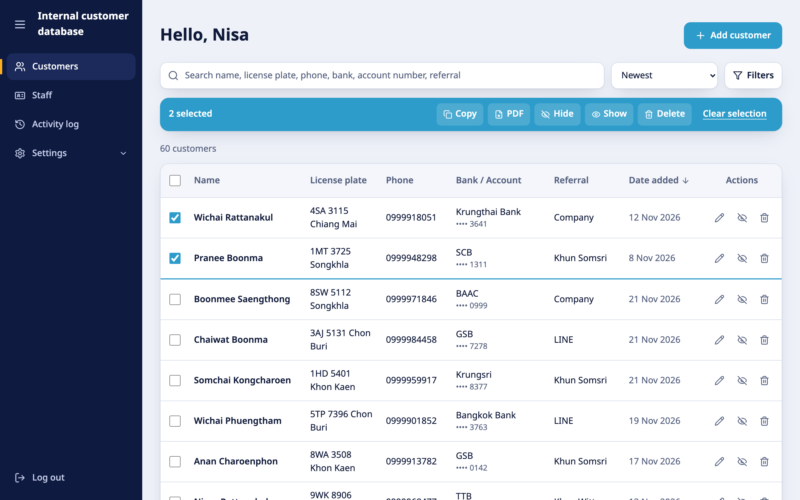
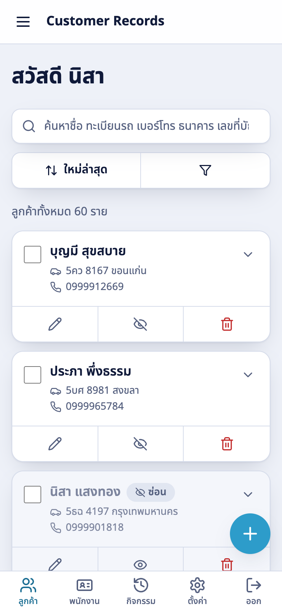

# Customer Records Web App

A secure internal web app for a small family business to collect, search and share customer records, including bank account details that staff use to make transfers. Customers register themselves through a QR-code form; admins and staff work with the data behind a login, with role-based access, a full activity log and a mobile-first Thai interface.

Built as real client work with Django, PostgreSQL, HTMX and Alpine.js.

## Why this app

The business used to keep customer details, including bank account numbers, in an Excel file, and collected them on paper, by phone or in chat. This app replaces both with one secure system.

**Each role sees only what it needs.** Anyone who opens a spreadsheet sees everything in it. Here, admins manage the full records, while staff see only what they need to make transfers: they never see customers' phone numbers, or customers an admin has hidden. The server enforces these rules on every page, search and export, not just in the menus.

**Every important action is recorded.** Excel can't tell you who changed, deleted or copied a customer's bank details. The app keeps an activity log of logins, edits, deletions, copies, shares and PDF exports, so the owner always knows who did what, and when.

**Customers register without staff.** Customers scan a QR code and fill in the form on their own phone, at any time. No staff member has to take down details, retype them or chase missing ones.

The same design makes the data more accurate and more private. Customers type their own account numbers, so staff never mishear or miscopy them, which matters because one wrong digit sends money to the wrong account. Every entry is checked, arrives in the same format and lands in one dated list, so nothing gets lost on paper or buried in chat, and bank details never sit on a desk or in someone's personal messages. Everyone works from one live copy instead of scattered file versions, the data is kept on a protected server instead of one laptop, and staff can search, copy and share to LINE from their phones in seconds.

## Interface

<table>
  <tr>
    <td width="50%"></td>
    <td width="50%"></td>
  </tr>
  <tr>
    <td align="center"><sub>Login</sub></td>
    <td align="center"><sub>Customer list (admin): ticked customers pinned on top, masked account numbers, a hidden customer greyed out</sub></td>
  </tr>
</table>

<p align="center">
  
  <br><sub>The same list on a phone: cards with icon actions and bottom tabs</sub>
</p>

<sub>All data shown is fake, generated by the <code>seed_demo</code> command.</sub>

## Features

**Customers (public)**
- QR-code registration form: mobile-first, server-side validation, honeypot and per-IP rate limiting against spam

**Staff and admins**
- Customer list with search-as-you-type, Thai dictionary sorting, filters, pagination and auto-refresh every 10 seconds
- Tick-to-pin selection: ticked customers stay at the top across searches, pages and refreshes
- Copy, share (native phone share sheet, e.g. to LINE) and PDF export with an embedded Thai font
- Phone layout with expandable cards and icon actions; desktop table with even column spacing
- Light, dark and system themes, saved per account

**Admins only**
- Add, edit, hide and delete customers (single or bulk, with typed confirmation)
- Staff account management: create, edit, reset password, deactivate
- Append-only activity log with filters, a detail page and CSV export
- Excel import command with dry run and all-or-nothing transactions

## Security and privacy

The app stores bank account numbers, so access rules are enforced on the server and covered by tests:

- **Default deny:** every page requires login except the login page and the QR form
- **Role-based visibility:** staff never receive customers' phone numbers or hidden customers, in any page, search, export or URL
- **Server re-checks every ID:** bulk actions only act on customers the user is allowed to see
- **Masked account numbers** in lists; the full number appears only in deliberate copy or PDF exports, each logged
- **Append-only audit log** that never stores phone or account numbers
- **Login lockout** after 5 failed attempts (django-axes), CSRF on every change, POST-only logout
- **Production hardening:** HTTPS redirect, HSTS, secure cookies, a strict Content-Security-Policy, real client IP behind the proxy, and no customer text ever placed in client-side code (tested with attack strings)
- **Self-hosted assets:** no CDNs, trackers or analytics

## Tech stack

| Layer | Technology |
|---|---|
| Backend | Python 3.15, Django 6.1 |
| Database | PostgreSQL 18 (Thai sorting with ICU collation) |
| Frontend | Server-rendered Django templates, HTMX 2, Alpine.js 3, Tailwind CSS 4 |
| PDF and Excel | fpdf2 with HarfBuzz text shaping, openpyxl |
| Security | django-axes, Django's built-in CSP and security middleware |
| Production | gunicorn, WhiteNoise, Render (web) and Neon (Postgres) |
| Tooling | uv, pytest + pytest-django, ruff |

## Architecture

A single Django project with three apps and one PostgreSQL database. It's deliberately simple: no separate API, no queues, no caches.

```
Browser ── HTMX (partial page swaps) + Alpine.js (selection, menus, theme)
   │
Django ─┬─ accounts/   users, login, roles, staff management
        ├─ customers/  customer model, list, filters, exports, QR form, Excel import
        └─ audit/      append-only activity log, CSV export, yearly archive
   │
PostgreSQL
```

**Design decisions**
- **Server-rendered HTML with HTMX** instead of a JavaScript framework: less code, and permissions are applied once, on the server.
- **One place for each rule:** `visible_customers(user)` is the only way views read customers, and one helper decides which fields a role may see.
- **Thin views, small service functions:** each action and its audit-log row run in one database transaction.
- **Settings from environment variables:** one `settings.py` for development and production; secrets never enter git.

## Getting started

Requirements: Python 3.15 via [uv](https://docs.astral.sh/uv/) and a local PostgreSQL.

```bash
git clone https://github.com/LynnAnya/customer-records-webapp.git
cd customer-records-webapp
createdb customer_records
cp .env.example .env          # then set SECRET_KEY (instructions inside the file)
uv run python manage.py migrate
uv run python manage.py create_admin yourname
uv run python manage.py seed_demo     # 60 fake customers for development
uv run python manage.py runserver
```

Then open http://127.0.0.1:8000.

## Tests

```bash
uv run pytest        # 396 tests: permissions, privacy rules, exports, security headers, import, UI fragments
uv run ruff check .
```

## Deployment

The app is set up for Render (web service) and Neon (PostgreSQL). `build.sh` installs the locked packages, collects static files, runs Django's production checks and applies migrations. Every setting is documented in [`.env.example`](.env.example). The name shown in the app comes from the `SITE_NAME` setting, so the client's name is never stored in the code.

## License

[MIT](LICENSE)
