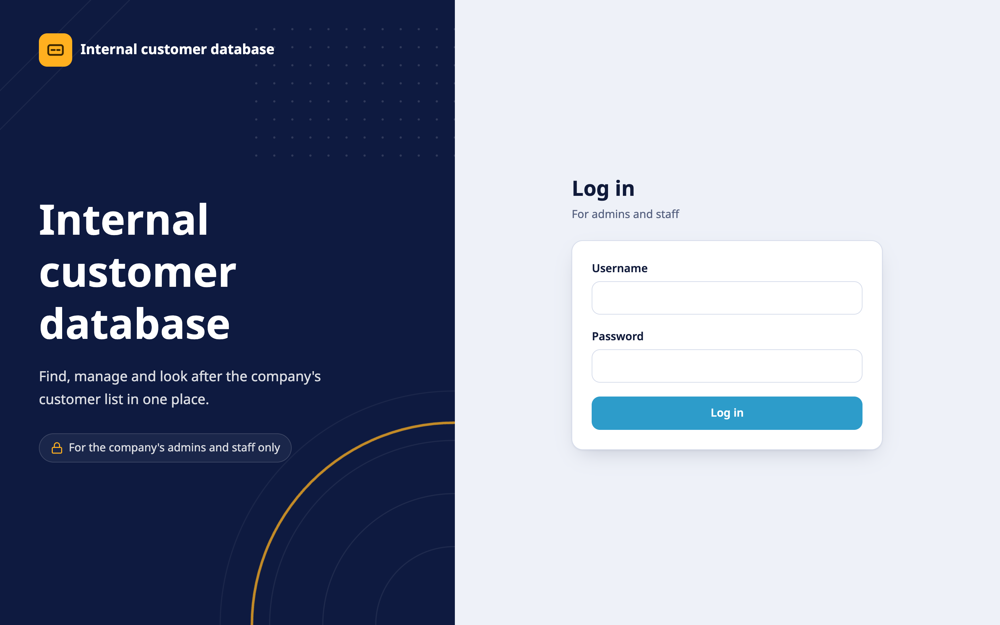

# Customer Records Web App

A customer database built for a small family business that pays its customers by bank transfer after they sell plastics for recycling. It replaces an Excel file or details collected on paper with one system: customers register themselves by QR code, staff find and send correct bank details in seconds, and the owner controls who sees what and knows who did what.

Built as real client work with Django, PostgreSQL, HTMX and Alpine.js.

## The problem

- **The records lived in one Excel file.** Anyone who opened it saw everything, copies drifted apart, and nothing showed who changed or copied what.
- **Details arrived on paper, by phone or in chat** and were retyped by staff. Every retyped account number is a chance to pay the wrong person.

The users are 1–2 admins, 2–3 staff and a few hundred customers, all Thai-speaking.

## Client requirements and how the app meets them

| Requirement | Solution |
|---|---|
| Customers give their own details, correctly | A public QR-code form on the customer's own phone, checked on the server and protected against spam |
| Staff pay customers without typing errors | One tap copies the name, bank and full account number, shares them to LINE, or creates a PDF |
| Staff see only what they need | Role-based access: staff never see customers' phone numbers, so customer contact stays with the business |
| The owner knows who did what | An append-only activity log of logins, changes, copies, shares and exports |
| Admins stay in control | Add, edit, hide and delete customers; create, reset and deactivate staff accounts |
| Keep the existing Excel data | An import command with a dry run that saves all rows or none |
| Works on phones, in Thai | Mobile-first layout, Thai interface, Thai alphabetical sorting and a Thai font in PDFs |
| Small team, small budget | One simple Django app and one database on low-cost hosting, easy to maintain |

## Why this app

**Each role sees only what it needs.** Admins see full records. Staff see what they need to make transfers, but never customers' phone numbers or customers an admin has hidden. The server enforces this on every page, search and export, not just in the menus.

**Every important action is recorded.** Excel can't tell you who changed, deleted or copied someone's bank details. The activity log can, so the owner always knows who did what, and when.

**Customers register without staff.** Customers fill in the form themselves, at any time, so nobody has to take down details, retype them or chase missing ones.

Together these make the data more accurate and more private: details are typed once by the person who knows them, checked, kept in one live place on a protected server, and never left on paper or in personal chats.

## Interface

<table>
  <tr>
    <td width="50%"></td>
    <td width="50%"></td>
  </tr>
  <tr>
    <td align="center"><sub>Login</sub></td>
    <td align="center"><sub>Customer list (admin): ticked customers pinned on top, masked account numbers</sub></td>
  </tr>
</table>

<p align="center">
  
  <br><sub>The same list on a phone: cards with icon actions and bottom tabs</sub>
</p>

<sub>The interface is shown in English for these images; the production app is in Thai. All data shown is fake.</sub>

## Roles

| | Admin | Staff | Public |
|---|:-:|:-:|:-:|
| Register through the QR form | | | ✓ |
| Search, filter and sort customers | All customers | Visible customers only | |
| See customers' phone numbers | ✓ | | |
| Copy, share and export PDF | ✓ | ✓ | |
| Add, edit, hide and delete customers | ✓ | | |
| Manage staff accounts | ✓ | | |
| Read the activity log | ✓ | | |

## Features

**Customers (public)**
- QR-code registration form: mobile-first, server-side validation, honeypot and per-IP rate limiting against spam

**Staff and admins**
- Customer list with search-as-you-type, Thai dictionary sorting, filters, pagination and auto-refresh every 10 seconds
- Tick-to-pin selection: ticked customers stay at the top across searches, pages and refreshes
- Copy, share (native phone share sheet, e.g. to LINE) and PDF export with an embedded Thai font
- Phone layout with expandable cards and icon actions; desktop table with even column spacing
- Light, dark and system themes, saved per account

**Admins only**
- Add, edit, hide and delete customers (single or bulk, with typed confirmation)
- Staff account management: create, edit, reset password, deactivate
- Append-only activity log with filters, a detail page and CSV export
- Excel import command with dry run and all-or-nothing transactions

## Security and privacy

The app stores bank account numbers, so access rules are enforced on the server and covered by tests:

- **Default deny:** every page requires login except the login page and the QR form
- **Role-based visibility:** staff never receive customers' phone numbers or hidden customers, in any page, search, export or URL
- **Server re-checks every ID:** bulk actions only act on customers the user is allowed to see
- **Masked account numbers** in lists; the full number appears only in deliberate copy or PDF exports, each logged
- **Append-only audit log** that never stores phone or account numbers
- **Login lockout** after 5 failed attempts (django-axes), CSRF on every change, POST-only logout
- **Production hardening:** HTTPS redirect, HSTS, secure cookies, a strict Content-Security-Policy, real client IP behind the proxy, and no customer text ever placed in client-side code (tested with attack strings)
- **Self-hosted assets:** no CDNs, trackers or analytics

## Tech stack

| Layer | Technology |
|---|---|
| Backend | Python 3.15, Django 6.1 |
| Database | PostgreSQL 18 (Thai sorting with ICU collation) |
| Frontend | Server-rendered Django templates, HTMX 2, Alpine.js 3, Tailwind CSS 4 |
| PDF and Excel | fpdf2 with HarfBuzz text shaping, openpyxl |
| Security | django-axes, Django's built-in CSP and security middleware |
| Production | gunicorn, WhiteNoise, Render (web) and Neon (Postgres) |
| Tooling | uv, pytest + pytest-django, ruff |

## Architecture

A single Django project with three apps and one PostgreSQL database. It's deliberately simple: no separate API, no queues, no caches.

```
Browser ── HTMX (partial page swaps) + Alpine.js (selection, menus, theme)
   │
Django ─┬─ accounts/   users, login, roles, staff management
        ├─ customers/  customer model, list, filters, exports, QR form, Excel import
        └─ audit/      append-only activity log, CSV export, yearly archive
   │
PostgreSQL
```

**Design decisions**, each driven by the client's situation
- **Server-rendered HTML with HTMX** instead of a JavaScript framework: less code for a small team to maintain, and permissions are applied once, on the server.
- **One Django app, one database, no API, queues or caches:** right-sized for a few users and a few hundred records, and cheap to host.
- **One place for each rule:** `visible_customers(user)` is the only way views read customers, and one helper decides which fields a role may see.
- **Thin views, small service functions:** each action and its audit-log row run in one database transaction.
- **Settings from environment variables:** one `settings.py` for development and production; secrets and the client's name (`SITE_NAME`) never enter git.

## My role

I built this project on my own for a real client: gathering the requirements, designing the data model, permissions and interface, writing the code and tests, and preparing the production deployment.

## Getting started

Requirements: Python 3.15 via [uv](https://docs.astral.sh/uv/) and a local PostgreSQL.

```bash
git clone https://github.com/LynnAnya/customer-records-webapp.git
cd customer-records-webapp
createdb customer_records
cp .env.example .env          # then set SECRET_KEY (instructions inside the file)
uv run python manage.py migrate
uv run python manage.py create_admin yourname
uv run python manage.py seed_demo     # 60 fake customers for development
uv run python manage.py runserver
```

Then open http://127.0.0.1:8000.

## Tests

```bash
uv run pytest        # 400+ tests: permissions, privacy rules, exports, security headers, import, UI fragments
uv run ruff check .
```

## Deployment

The app is set up for Render (web service) and Neon (PostgreSQL). `build.sh` installs the locked packages, collects static files, runs Django's production checks and applies migrations. Every setting is documented in [`.env.example`](.env.example). The name shown in the app is set per deployment with `SITE_NAME`.

## License

[MIT](LICENSE)
